<p align="center">
  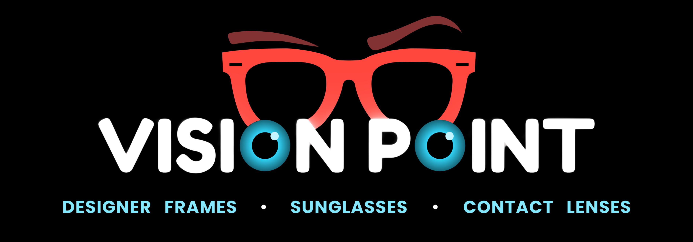
</p>

<h1 align="center">Vision Point CRM</h1>

<p align="center">
  A custom Android app for running an optical store: customers, eye prescriptions, billing, payments and the cashbook.
</p>

<p align="center">
  
  
  
  
  
  
</p>

<p align="center">
  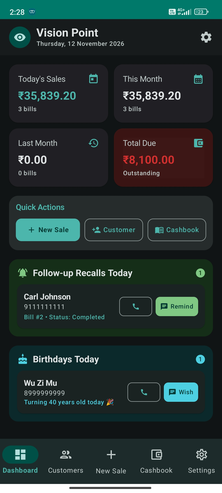
  &nbsp;
  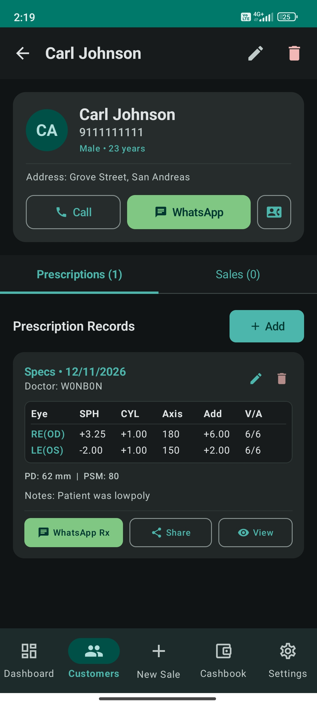
  &nbsp;
  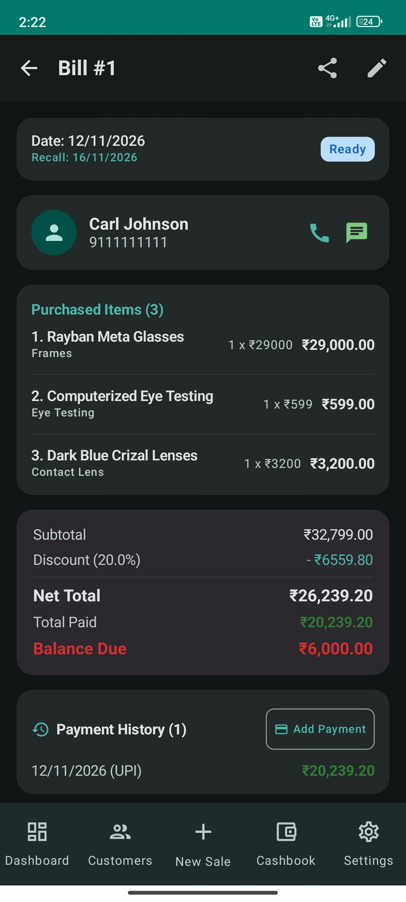
</p>

---

## About

**Vision Point** is an optical store in Saket, New Delhi, selling designer frames, sunglasses and contact lenses and offering eye testing. Before this app, customer records, prescriptions, bills and the daily cash ledger were kept in separate notebooks and chat threads.

Vision Point CRM puts all of that into one offline-first Android app on the shop's phone. It was built for this business specifically. The workflows, fields, invoice layout and WhatsApp messages all follow how the store's staff already work, so it is not a generic CRM with an optical label added.

## What it does

### 👥 Customer CRM
- Customer profiles keyed by phone number (unique), with gender, date of birth or age, address and notes
- One tap to **Call**, **WhatsApp**, or **save to phone contacts** (the app detects when a customer is already saved)
- A tabbed profile with the customer's full **prescription history** and **sales history**

### 👓 Prescription management
- Separate records for **spectacles** and **contact lenses**, with SPH, CYL, Axis, Add and V/A for the right eye (OD) and left eye (OS)
- PD, PSM and fitting-height measurements, the doctor's name and notes
- A flag for prescriptions taken *"as per patient's previous lenses"*
- A **wheel-based power picker** (sign · whole · quarter-step) instead of free text, which removes typos like `-1.3` or `+2.5O`. A **Copy to Left** button handles patients with the same power in both eyes
- A branded **prescription PDF** that can be viewed, shared, or sent straight to the customer on WhatsApp

### 🧾 Sales & invoicing
- Bills with several line items (frames, lenses, contact lenses, eye testing and more). Each item has a customer-facing name and **internal notes** that are not printed on the bill
- A sale can be linked to a prescription so the lens order matches the right Rx
- Discounts as a **percentage or a flat ₹ amount**; subtotal, net, received and balance-due amounts update as you type
- **Split and partial payments** across Cash, Card and UPI, with a full payment history
- An order lifecycle of **Pending → Ready → Completed**, with colour-coded status chips and filters
- **Recall dates** for follow-up visits
- Branded A4 **invoice PDFs** with the store header and footer, plus one-tap **WhatsApp bill**, **"Spectacle Ready" alert** and **due-payment reminder** messages

### 💰 Cashbook ledger
- Credit and debit entries with totals and net balance
- Filters by direction (credit/debit) and by method (Cash/Card/UPI)
- Every payment recorded against a bill is **added to the cashbook automatically**, so the ledger always matches sales

### 📊 Dashboard & daily reminders
- Today's sales, this month, last month and total outstanding dues at a glance
- Quick actions for a new sale, a new customer and the cashbook
- **Follow-up recalls due today** and **customer birthdays today**, each with Call and WhatsApp *Remind* or *Wish* buttons
- A background **daily reminder** sends notifications for recalls, birthdays and outstanding dues. Tapping one opens the relevant screen, and each reminder type can be turned on or off in Settings

### ⚙️ Settings & data safety
- Light, dark or system theme
- Per-category notification toggles
- **One-tap database backup** to Downloads, which can also be shared to Drive or WhatsApp. All data stays on the device

## Design

The design goal was an app that staff behind a busy counter can use quickly with one hand.

- **Brand-led palette.** Deep teal and cyan from the Vision Point logo are used across a custom Material 3 colour scheme. Dynamic colour is off by default so the brand stays consistent, and a dark theme suits all-day use.
- **Colour that carries meaning.** Green means money in or paid, red means a balance due or a debit, and amber, blue and green chips mark Pending, Ready and Completed orders. Owners can read the state of the business at a glance.
- **Domain-specific inputs.** The eye-power wheel picker, Rx table layout, OD/OS labels and quarter-dioptre steps match how opticians actually write prescriptions.
- **Built around WhatsApp.** In India, WhatsApp is how a store talks to its customers. Bills, prescriptions, ready alerts, due reminders and birthday wishes are all one tap away, with pre-filled messages.
- **Matching print output.** The PDF invoices and prescriptions use the store's own header and footer artwork, with Quicksand for display text and Roboto Mono for figures, so printed documents look like the store's brand.
- **Bottom-nav shell.** Dashboard, Customers, New Sale, Cashbook and Settings, with *New Sale* in the centre because it is the most frequent action.

## Generated documents

Invoices and prescriptions are generated **on the device**, with no server or third-party PDF library. `PdfGenerator` draws each A4 page directly with Android's `PdfDocument` and `Canvas` APIs:

- The store's own **header and footer artwork** frame every page, with the shop phone number, address and a closing message
- **Quicksand** is used for labels and headings and **Roboto Mono** for figures, so amounts and powers line up in columns
- **Invoice:** billed-to and invoice-summary panels, an itemised table, payment history, and a totals block with discount, net, received and a red **balance due**
- **Prescription ("Vision Rx"):** patient and Rx details, an OD/OS power table (SPH · CYL · Axis · Add · V/A), and PD/PSM measurements
- Long text wraps to fit its column, and internal item notes are never printed on the bill
- The finished PDF can be **viewed**, **shared**, or **sent to the customer's WhatsApp** in one tap through a `FileProvider` URI

<table align="center">
  <tr>
    <td align="center">
      <a href="screenshots/sample-invoice.pdf">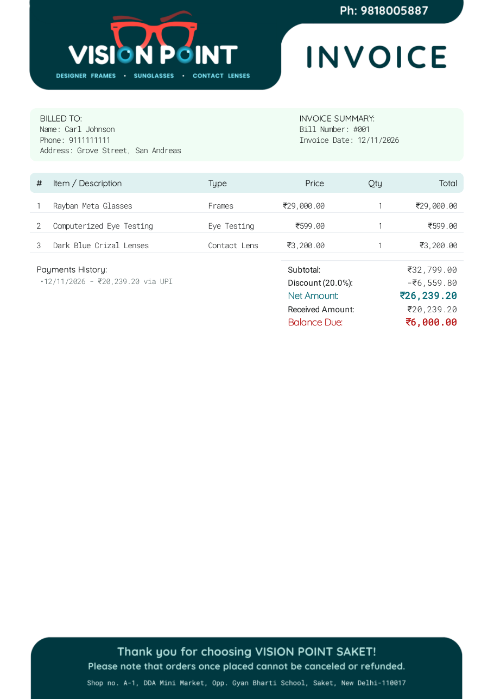</a><br>
      <sub><b>Invoice</b> · <a href="screenshots/sample-invoice.pdf">open PDF</a></sub>
    </td>
    <td align="center">
      <a href="screenshots/sample-prescription.pdf">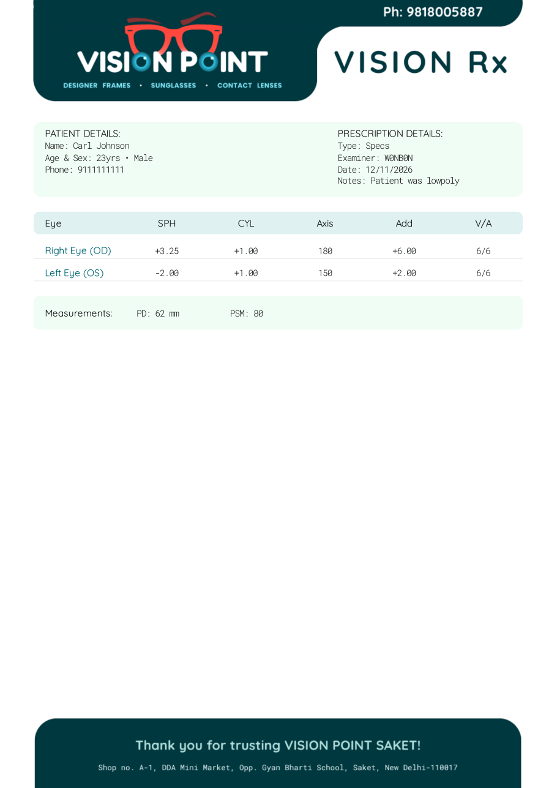</a><br>
      <sub><b>Prescription</b> · <a href="screenshots/sample-prescription.pdf">open PDF</a></sub>
    </td>
  </tr>
</table>

## Architecture & tech

| Concern | Choice |
|---|---|
| Language | Kotlin (JVM 17) |
| UI | Jetpack Compose + Material 3, single-activity |
| Navigation | Navigation Compose with typed route builders and deep links from notifications |
| State | MVVM with `ViewModel` + Kotlin `Flow` / `StateFlow`, collected with lifecycle awareness |
| Persistence | Room (SQLite) with foreign keys, indices, relations and type converters |
| DI | Hilt (including `HiltWorker` for background jobs) |
| Background work | WorkManager, using a 24-hour periodic job aligned to a daily time |
| Documents | Android `PdfDocument` + `Canvas`, with hand-laid invoice and Rx templates |
| Serialization | kotlinx.serialization (per-eye Rx values stored as JSON) |
| Sharing | `FileProvider` + WhatsApp deep links (`wa.me`) |

**Engineering notes**

- **Offline-first by design.** Everything runs locally on Room, so the shop keeps working without internet. Backups are a single exportable `.db` file.
- **Referential integrity in the schema.** Deleting a customer cascades to their prescriptions. Sales `RESTRICT` customer deletion so financial records can't be orphaned. A deleted prescription `SET NULL`s on sales that used it.
- **A single source of truth for money.** Sale totals and dues are derived from line items and payments, and payments write through to the cashbook, so the ledger and the bills cannot drift apart.
- **Layered structure.** DAOs → repositories → ViewModels → Compose screens, wired together with Hilt.

```
Customer 1──* Prescription
Customer 1──* Sale *──0..1 Prescription
Sale     1──* SaleItem
Sale     1──* Payment 1──0..1 Cashbook entry
```

### Project structure

```
app/src/main/java/com/visionpoint/crm/
├── data/
│   ├── database/     # Room database, DAOs, type converters
│   ├── model/        # Customer, Prescription, Sale, SaleItem, Payment, Cashbook, Setting
│   └── repository/   # Repositories over the DAOs
├── di/               # Hilt modules
├── navigation/       # Routes and NavGraph
├── ui/
│   ├── components/   # Eye-power picker, chips, cards, search, date and dropdown fields
│   ├── screens/      # dashboard · customers · prescriptions · sales · cashbook · settings
│   └── theme/        # Brand colour schemes, typography
├── util/             # PDF generator, WhatsApp/share, backup, contacts, date and Rx helpers
└── worker/           # Daily reminder worker + scheduler
```

## More screens

<p align="center">
  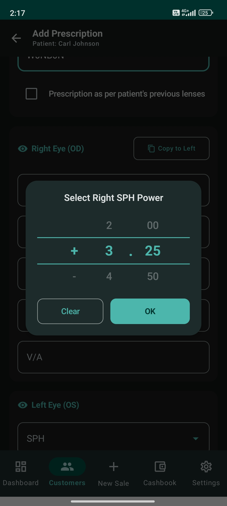
  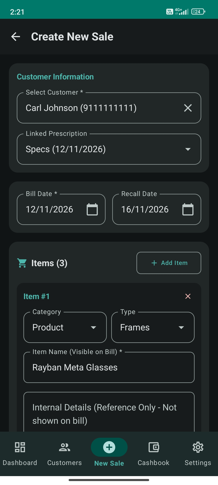
  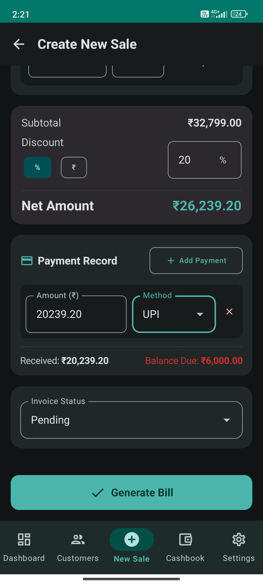
  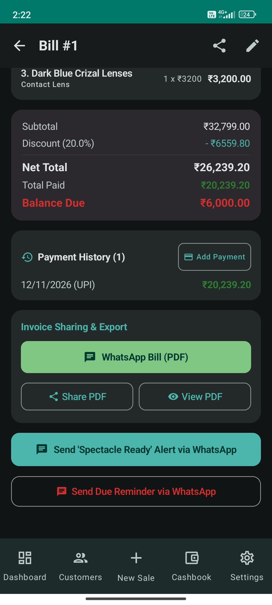
</p>
<p align="center">
  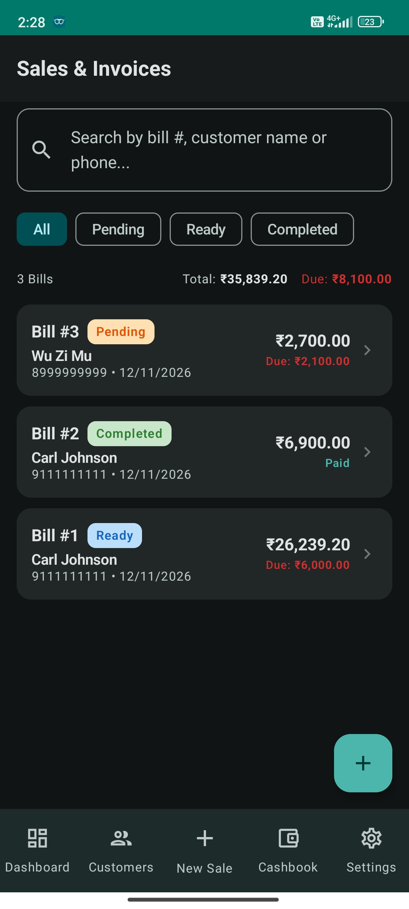
  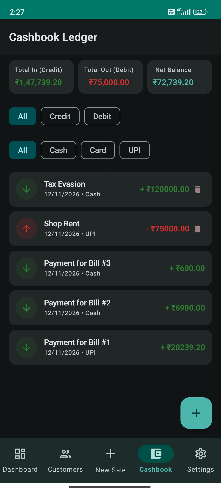
  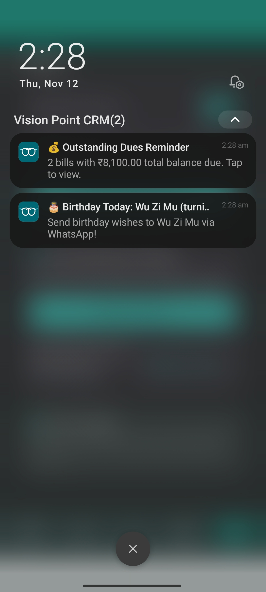
</p>

<sub>All screenshots use dummy data.</sub>

## Getting started

1. Open the project in a recent **Android Studio** release (AGP 8 / Kotlin 2).
2. Let Gradle sync. `local.properties` is generated with your SDK path.
3. Run the `app` configuration on a device or emulator with **API 26 or higher**.

- **Package:** `com.visionpoint.crm` · **Target SDK:** 34 · **Version:** 1.0.2

Release builds are signed with a private keystore, which is kept out of version control.

## Related

- **Backend (reference):** a FastAPI + SQLAlchemy service (Turso/libSQL, deployed on Render) that models the same domain. It lives in its own repository, `VP-CRM-backend`.

## License

Proprietary. Built for Vision Point. All rights reserved.
